Desenvolvedor full stack em João Pessoa, PB · programando desde 2022

---

## 🧰 Stack

Clique em um ícone para abrir a documentação da tecnologia.

  
  
  
  
  
  
  
  
  
  
  
  
  
  
  

<b>🎨 Front-end</b> — interfaces rápidas e fáceis de manter

 

      

- Angular 17+ com bindings, services, mocks e testes com Jasmine.
- React no chat principal da Ideen, com foco em performance.

<b>⚙️ Back-end</b> — APIs robustas e bem estruturadas

 

     

- APIs em .NET com Clean Architecture e integração com APIs de terceiros.
- Back-end em Node.js e ecossistema Spring.

<b>🗄️ Dados &amp; Cloud</b> — SQL, dashboards e serverless

 

     

- Queries e stored procedures otimizadas em produção.
- Rotinas serverless no AWS Lambda (Python e Node.js).
- Dashboards em Power BI com ETL em Python.

<b>🤖 Automação</b> — menos trabalho manual, mais resultado

 

   

- RPAs que eliminaram fechamentos fiscais manuais de empresas clientes.
- Workflows no n8n integrando diferentes sistemas.

<b>🛠️ Ferramentas</b>

 

   

---

## 🎓 Formação

<b>📜 Cursos e certificações</b> (5)

 

| | Curso |
| :---: | :--- |
| 🔀 | Introdução ao Git e ao GitHub |
| 🌿 | Git e Versionamento |
| 🧠 | Pensamento Computacional |
| 🐍 | Ampliando o Conhecimento em POO com Python |
| 🎮 | Criando um Projeto com HTML/CSS para Listagem de Pokémons |

<b>💼 Trajetória profissional</b>

 

| Período | Empresa | Cargo |
| :--- | :--- | :--- |
| nov 2025 — atual | **Minsait** | Desenvolvedor Full Stack |
| mai 2024 — nov 2025 | **Ideen Tecnologia e Finanças** | Desenvolvedor de Software |
| mai 2024 — dez 2024 | **Go Beesiness** | Desenvolvedor Full Stack |
| ago 2023 — mai 2024 | **Construtora Alliance** | Técnico de Suporte em TI |
| dez 2022 — ago 2023 | **Construtora Alliance** | Estagiário de TI · Análise de Dados |

---

<b>📊 Estatísticas do GitHub</b>

 

  
  

  <picture>
    <source media="(prefers-color-scheme: dark)" srcset="https://raw.githubusercontent.com/edilsonjrcode/edilsonjrcode/output/github-snake-dark.svg" />
    
  </picture>

